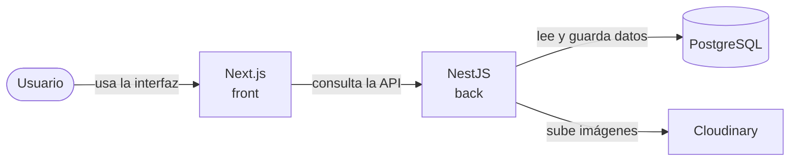
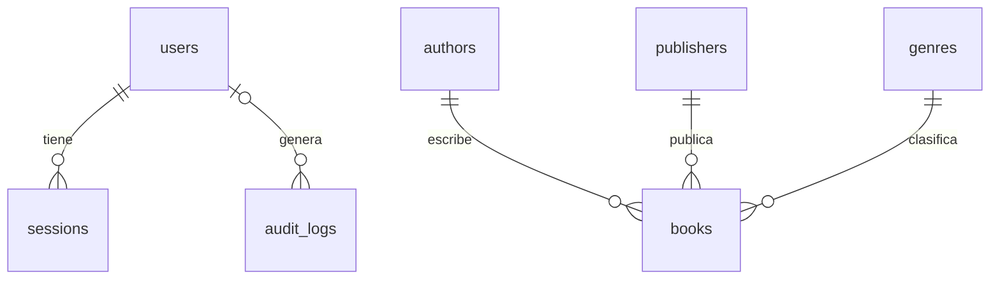

# CMPC-Libros

Gestión de libros.

- `cmpc-back`: NestJS, Prisma, PostgreSQL.
- `cmpc-front`: Next.js.

## ¿Cómo lo levanto?

```bash
cp cmpc-back/.env.example cmpc-back/.env
cp cmpc-front/.env.example cmpc-front/.env
docker compose up --build
```

- Front: <http://localhost:3000>
- API: <http://localhost:3001>
- Swagger: <http://localhost:3001/docs>
- Usuario admin de prueba: `admin@cmpc.test` / `Asd123.`

## ¿Y para desarrollar?

Requiere Node 24 y Docker.

```bash
cp cmpc-back/.env.example cmpc-back/.env
cp cmpc-front/.env.example cmpc-front/.env

cd cmpc-back
npm install
npm run db:up      # levanta PostgreSQL
npm run db:deploy  # crea las tablas
npm run db:seed    # solo la primera vez
npm run dev        

cd cmpc-front
npm install
npm run dev
```

## ¿Cómo uso la aplicación?

1. Ingresa con el usuario del seed.
2. En **Libros**: busca, filtra por género, editorial, autor y disponibilidad, y ordena por uno o más campos.
3. Cambia entre vista de cuadrícula y lista.
4. **Nuevo libro** crea; el lápiz edita; la papelera elimina.
5. Al elegir una portada se puede encuadrar antes de guardar.
6. **Exportar CSV** descarga con los filtros actuales.
7. La sesión se cierra tras 5 minutos sin actividad (avisa 60 segundos antes).

## ¿Cómo está armado?



El back sigue arquitectura hexagonal por módulos (`auth`, `users`, `catalog`, `books`, `audit`), cada uno con `domain`, `application` e `infrastructure`.

## ¿Cuál es el modelo de datos?



Esquema completo: `cmpc-back/migrations/prisma/schema.prisma`.

## ¿Qué endpoints hay?

Todos exigen login salvo los públicos. Detalle y pruebas en Swagger.

| Ruta | Qué hace |
| --- | --- |
| `GET /health`, `GET /health/ready` | Salud (público) |
| `POST /auth/login`, `POST /auth/refresh` | Iniciar y renovar sesión (público) |
| `POST /auth/logout` | Cerrar sesión |
| `GET /users/me` | Perfil |
| `GET`, `POST /catalog/:kind` | Autores, editoriales y géneros |
| `GET /books` | Listado con filtros, orden y paginación |
| `GET /books/export` | CSV |
| `GET`, `POST`, `PATCH`, `DELETE /books/:id` | CRUD (el borrado es lógico) |

## ¿Cómo funciona la autenticación?

- JWT de acceso y de renovación, de 5 minutos, en cookies `httpOnly`.
- Cada token pertenece a una sesión en base de datos: cerrar sesión lo invalida al instante.
- El refresh rota; si se reutiliza uno viejo, se cierran todas las sesiones del usuario.
- Se asume que es una herramienta interna: todo usuario autenticado puede gestionar libros. El rol (`ADMIN` o `USER`) está en el modelo, pero no se usa para restringir acciones.

## ¿Dónde se guardan las imágenes?

Se suben a Cloudinary y en la base solo se guarda la URL. Antes de subirlas, el servidor las sanitiza: valida el formato real (JPEG, PNG o WebP, hasta 5 MB) y las reescribe como WebP, lo que elimina metadatos y cualquier contenido embebido.

## ¿Qué pasa al eliminar un libro?

Soft delete: se guarda `deletedAt` y deja de aparecer en listados y CSV. La fila sigue en la base.

## ¿Cómo corro los tests?

```bash
cd cmpc-back && npm run test:cov
cd cmpc-front && npm run test:cov
```

## ¿Qué hay que cuidar en producción?

- Servir todo con HTTPS y quitar `COOKIE_SECURE=false` de `cmpc-back/.env`.
- `NEXT_PUBLIC_API_URL` (en `cmpc-front/.env`) cambiar la URL pública de la API antes de construir la imagen.
- `TRUST_PROXY=0` cambiarlo a `TRUST_PROXY=1` si es que hay un proxy (como un load balancer) antes de llegar a la api y definir `CORS_ORIGIN` con el origen del front.
- Guardar los secretos en un gestor.
- Apagar Swagger con `SWAGGER_ENABLED=false` si no debe ser público.
- Enviar logs a un agregador (CloudWatch, Datadog, Loki) para no perderlos al reiniciar el contenedor.

## ¿Qué quedó como mejora?
- **Stock:** Solo se tiene `disponible sí o no`. No hay cantidades ni historial de movimientos (entradas, salidas, ajustes). Un campo stock y una tabla de movimientos cambian el sentido del sistema.
- **Panel de análisis:** Un endpoint de agregaciones (totales por género y editorial, libros sin stock, altas por mes).
- **DPoP:** atar el token a una llave del dispositivo para que uno robado no sirva.
- **Redis:** compartir el límite de peticiones entre réplicas.
- **Tests end-to-end.**

## ¿Qué decisiones de diseño se tomaron?

**Arquitectura y datos**
- Uso de arquitectura hexagonal por módulos, para poder cambiar de ORM o proveedor sin tocar la lógica.
- Imágenes en Cloudinary, con solo la URL en la base, para que no dependan del disco del contenedor.
- Sanitización de imágenes en el servidor, para eliminar metadatos y contenido malicioso.
- Transacciones en edición, listado y rotación del refresh token, para mantener los datos consistentes.
- Concurrencia optimista al editar, con respuesta 409, para que dos personas no se pisen los cambios.
- Índices compuestos parciales sobre libros activos, para que el listado, los filtros y el orden sean rápidos con miles de libros


**Autenticación y seguridad**
- Tokens de 5 minutos en cookies `httpOnly`, para que el JavaScript del navegador no pueda leerlos.
- Sesiones guardadas en base de datos, para invalidar el token al instante al cerrar sesión.
- Refresh rotativo con detección de reuso, para cerrar todas las sesiones si se roba un token.
- Login que no revela si el correo existe, para no dar pistas a quien intente adivinar cuentas.
- Límite de peticiones por IP, para frenar la fuerza bruta de contraseñas.
- `TRUST_PROXY=0` por defecto, para que nadie falsifique su IP y evada el límite.
- Cierre de sesión por inactividad a los 5 minutos, para no dejar sesiones abiertas olvidadas.

**Comportamiento de la API**
- Filtros, orden y paginación en el servidor, para no cargar todos los libros en el navegador.
- Búsqueda con debounce de 350 ms, para no hacer una petición por cada tecla.
- Exportación CSV con protección contra inyección de fórmulas, para que Excel no ejecute contenido malicioso.
- Respuestas y errores con formato único y `requestId`, para que el front los trate igual y se pueda rastrear un error.
- Auditoría con decorador `@Audit()` e interceptor, para registrar quién hizo qué sin repetir código.
- Logs solo en los puntos clave, con formato `[Clase][metodo][Request|Response|Error]`, para seguir el flujo sin llenar el log de ruido.

**Configuración y despliegue**
- Seed idempotente con el admin fijo en el código, para poder correrlo varias veces sin duplicar datos.
- Migraciones como servicio de un solo uso, para que la base esté lista antes de arrancar la API.
- Healthchecks de proceso y de base de datos (`/health` y `/health/ready`), para que el orquestador sepa si la API está viva y lista.
- Contenedores endurecidos: usuario no root y sin capacidades de Linux, para reducir el daño si alguien los compromete.
- Swagger controlado por `SWAGGER_ENABLED`, para poder ocultar la documentación en producción.