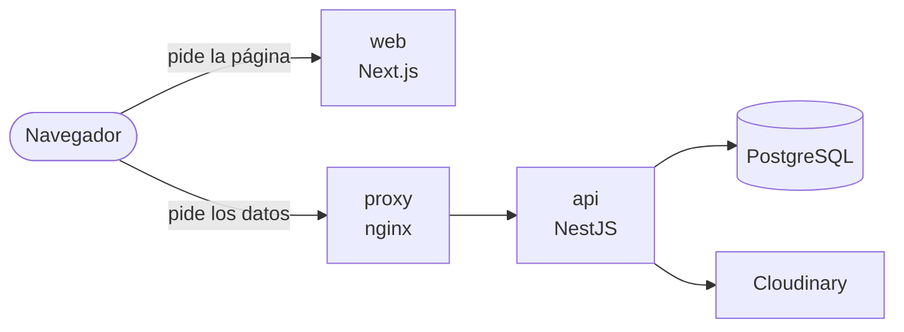
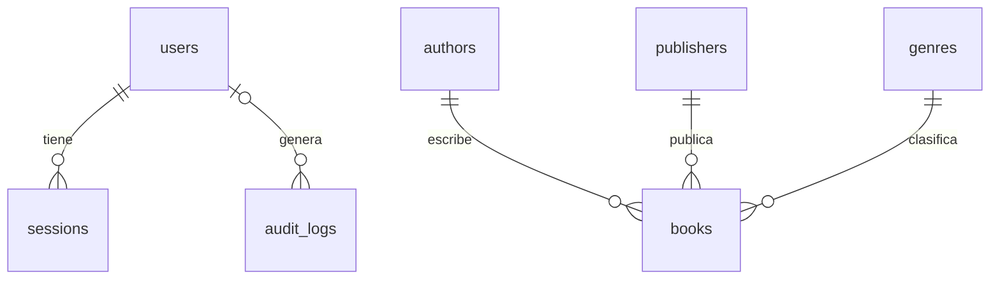

# CMPC-Libros

Gestión de libros.

- `cmpc-back`: NestJS, Prisma, PostgreSQL.
- `cmpc-front`: Next.js.

## ¿Cómo lo levanto?

Con Docker:

```bash
cp cmpc-back/.env.example cmpc-back/.env
cp cmpc-front/.env.example cmpc-front/.env
docker compose up --build
```

- Front: <http://localhost:3000>
- API: <http://localhost:3001>
- Swagger: <http://localhost:3001/docs>
- Usuario: `admin@cmpc.test` / `Asd123.`

Las variables están en `cmpc-back/.env` y `cmpc-front/.env`; los ejemplos ya traen secretos de prueba que funcionan. Solo falta `CLOUDINARY_API_SECRET` para subir portadas.

Para empezar de cero: `docker compose down -v`.

## ¿Y para desarrollar?

Requiere Node 24 y Docker.

```bash
cp cmpc-back/.env.example cmpc-back/.env
cp cmpc-front/.env.example cmpc-front/.env

cd cmpc-back
npm install
npm run db:up      # levanta PostgreSQL
npm run db:deploy  # crea las tablas
npm run db:seed    # solo la primera vez
npm run dev        # API en :3001
```

En otra terminal:

```bash
cd cmpc-front
npm install
npm run dev        # :3000
```

## ¿Cómo uso la aplicación?

1. Ingresa con el usuario del seed.
2. En **Libros**: busca, filtra por género, editorial, autor y disponibilidad, y ordena por uno o más campos.
3. Cambia entre vista de cuadrícula y lista.
4. **Nuevo libro** crea; el lápiz edita; la papelera elimina.
5. Al elegir una portada se puede encuadrar antes de guardar.
6. **Exportar CSV** descarga con los filtros actuales.
7. La sesión se cierra tras 5 minutos sin actividad (avisa 60 segundos antes).

## ¿Cómo está armado?



El back sigue arquitectura hexagonal por módulos (`auth`, `users`, `catalog`, `books`, `audit`), cada uno con `domain`, `application` e `infrastructure`.

## ¿Cuál es el modelo de datos?



Esquema completo: `cmpc-back/migrations/prisma/schema.prisma`.

## ¿Qué endpoints hay?

Todos exigen login salvo los públicos. Detalle y pruebas en Swagger.

| Ruta | Qué hace |
| --- | --- |
| `GET /health`, `GET /health/ready` | Salud (público) |
| `POST /auth/login`, `POST /auth/refresh` | Iniciar y renovar sesión (público) |
| `POST /auth/logout` | Cerrar sesión |
| `GET /users/me` | Perfil |
| `GET`, `POST /catalog/:kind` | Autores, editoriales y géneros |
| `GET /books` | Listado con filtros, orden y paginación |
| `GET /books/export` | CSV |
| `GET`, `POST`, `PATCH`, `DELETE /books/:id` | CRUD (el borrado es lógico) |

## ¿Cómo funciona la autenticación?

- JWT de acceso y de renovación, de 5 minutos, en cookies `httpOnly`.
- Cada token pertenece a una sesión en base de datos: cerrar sesión lo invalida al instante.
- El refresh rota; si se reutiliza uno viejo, se cierran todas las sesiones del usuario.

## ¿Dónde se guardan las imágenes?

El PDF no lo define. Se suben a Cloudinary y en la base solo se guarda la URL. El servidor valida el formato real, acepta JPEG, PNG y WebP de hasta 5 MB, y las reescribe como WebP.

## ¿Qué pasa al eliminar un libro?

Soft delete: se guarda `deletedAt` y deja de aparecer en listados y CSV. La fila sigue en la base.

## ¿Qué más incluye el back?

- Interceptor que envuelve todas las respuestas en `{ success, data, meta? }`.
- Auditoría de operaciones en base de datos y logs.
- Transacciones en la edición de libros, el listado y la rotación del refresh.
- Límite de peticiones por IP.

## ¿Cómo corro los tests?

```bash
cd cmpc-back && npm run test:cov
cd cmpc-front && npm run test:cov
```

Ambos exigen 80 % de cobertura.

## ¿Qué hay que cuidar en producción?

- Servir todo con HTTPS y quitar `COOKIE_SECURE=false` de `cmpc-back/.env`.
- `NEXT_PUBLIC_API_URL` (en `cmpc-front/.env`) se fija al compilar el front: pon la URL pública de la API antes de construir la imagen.
- Con el `proxy` nginx del compose, `TRUST_PROXY=1` ya viene puesto. Con un balanceador propio, ajusta `TRUST_PROXY` a su número de saltos (por ejemplo `2` con CloudFront y ALB) y define `CORS_ORIGIN` con el origen del front.
- Guardar los secretos en un gestor y cambiar la contraseña del usuario admin que crea el seed (está en `cmpc-back/migrations/prisma/seed.ts`).
- Apagar Swagger con `SWAGGER_ENABLED=false` si no debe ser público.

## ¿Qué quedó como mejora?

- **DPoP:** atar el token a una llave del dispositivo para que uno robado no sirva.
- **Redis:** compartir el límite de peticiones entre réplicas.
- **Tests end-to-end.**
- **Panel de análisis:** totales por género y editorial.
